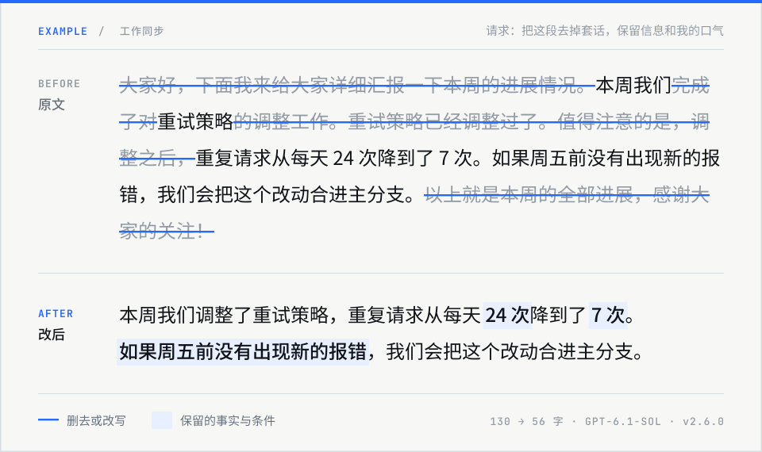

<p align="center">
  
</p>

<p align="center">
  <a href="https://github.com/MrGeDiao/shuorenhua/stargazers"></a>
  <a href="https://github.com/MrGeDiao/shuorenhua/releases"></a>
  <a href="LICENSE"></a>
</p>

说人话是一份给中文去 AI 味的改稿规则（skill），装进 Claude Code、Codex、Cursor、ChatGPT 就能用。把文字交给它，它删掉套话、重复铺垫和生硬句式，交回一版能直接用的稿子。数字、条件、承诺和你的口气默认都留着，本来没问题的文字不动。

```bash
npx skills add MrGeDiao/shuorenhua
```

<p align="center">
  
</p>

<details>
<summary>看不清图？这里是文字版，可以复制去试</summary>

原文：

> 大家好，下面我来给大家详细汇报一下本周的进展情况。本周我们完成了对重试策略的调整工作。重试策略已经调整过了。值得注意的是，调整之后，重复请求从每天 24 次降到了 7 次。如果周五前没有出现新的报错，我们会把这个改动合进主分支。以上就是本周的全部进展，感谢大家的关注！

改后：

> 本周我们调整了重试策略，重复请求从每天 24 次降到了 7 次。如果周五前没有出现新的报错，我们会把这个改动合进主分支。

请求是「把这段去掉套话，保留信息和我的口气」，由 GPT-6.1-sol 加载 v2.6.0 跑出，输出没有手改。同一段交给 Claude Opus 5.5，结果只多留了「调整之后，」。

</details>

## 安装

**Claude Code**

```text
/plugin marketplace add MrGeDiao/shuorenhua
/plugin install shuorenhua@shuorenhua
```

**Codex、Cursor 和其他支持 skills 的工具**

```bash
npx skills add MrGeDiao/shuorenhua
```

运行后选择要装到哪些工具，一共只装四个文件。默认只对当前项目生效，加 `--global` 后所有项目都能用。

**ChatGPT**：新建一个 Project，传入四个文件，[步骤在这里](install/chatgpt.md)。用过说人话 GPT 的话也要换：OpenAI 计划在 2026 年 12 月 11 日停用 Custom GPT。

想手动复制文件、装到 OpenClaw，或只想贴一段提示词，见[安装说明](install/)。

## 两种用法

| | 直接改（默认） | 修订稿（v2.7 新增） |
|---|---|---|
| 适合 | 邮件、周报、说明、短文 | 黑话多的长文，每处改动都想自己把关 |
| 交回 | 改好的全文 | 改动清单，加改好的全文 |
| 拿不准的地方 | 留着不动 | 也改，标「猜的」，写明选了哪种读法 |
| 不同意某处改动 | 再说一句要求，重改 | 回复编号，那一处逐字还原 |
| 怎么打开 | 不用打开 | 说「给我一份修订稿」或「彻底清理」 |

装好后不用记命令。在对话里贴上原文、说一句要求，工具会自己调用；想确保用上，在要求里点名「用说人话」。

```text
把这段去掉套话，保留信息和我的口气：……
只在句内改，不删句、不并句：……
别吹，写平实点：……
只标问题，不改写：……
给我一份修订稿，逐条列出改动，我来决定留哪些：……
```

直接改时只交改好的全文，不附评分和解释；原文没问题就原样返回。中文为主，英文也能改。

## 改什么，留什么

| 会清理 | 会保留 |
|---|---|
| 没有内容的招呼、预告和致谢 | 数字、日期、版本号 |
| 「值得注意的是」这类提示语 | 条件、承诺和分寸：「如果」「得到批准后」「可能」 |
| 「完成了对……的调整工作」这类绕弯的说法 | 引语、术语、代码块 |
| 同一件事说两遍 | 你的判断和口气，默认连像宣传的评价也留着 |

它不判断文章是不是 AI 写的，也不保证能通过 AI 检测。

<details>
<summary>控制改动范围</summary>

| 要求 | 改动范围 |
|---|---|
| 自由调整 / `structural` | 可删、并、重排，保留有效信息和作者意图 |
| 保留结构 / `bounded` | 只在句内清理；整句删除只提建议，不并句、不重排 |
| 只在原位改 / `in-place` | 不删句、不并句、不重排；要求保句数时也不拆句 |

你的要求优先。约 1000 字以上的中文公开长文，默认保留原来的段落和句子结构。

</details>

<details>
<summary>写平实：去掉宣传腔（v2.6）</summary>

只有你说了「别吹」「写平实点」「去掉营销味」，它才会多做一步：把只表示程度的夸张词（「极致」「完美」）换成平常说法，删掉不交代内容的口号：

> 这款记账软件采用全新一代同步引擎，带来极致流畅的体验，真正做到无需妥协。它是国内首个支持离线多人协作的记账工具，导入旧数据无需手动整理，同步速度提升了 3 倍。

改成：

> 这款记账软件采用新一代同步引擎，用起来很流畅。它是国内首个支持离线多人协作的记账工具，导入旧数据无需手动整理，同步速度提升了 3 倍。

承诺、可核查的「首个」、数字和术语照样保留。只降调，不加强。只说「去 AI 味」「改狠一点」不会打开。

</details>

## 修订稿

长文里的黑话，默认模式改得偏少：规则是拿不准就留着，而黑话正好是说不清具体指什么的词。修订稿反过来做，拿不准的也改，但每一处都列出来，由你决定留不留。

只有你说了「修订稿」「逐条列出改动」「彻底清理」或「所有黑话都换成大白话」才会进入这个模式。只说「去 AI 味」「改狠一点」不会。

### 它交回什么

下面是 Claude Code（Opus 5.5）的真实输出。原文是一篇约 2400 字、讲企业数字化转型的 AI 生成文章，请求是「请彻底清理这篇文章的 AI 味，所有黑话都换成大白话；保留原来的段落和结构，不删句、不并句；用修订版或批注格式标出改动」。这里只节选三段，省略的地方用 `……` 标出，其余一个字没改。

```text
判断：黑话较多
不动：“转”（贯穿全文的说法）、“赋能”、“中台”、“智能化”（被讨论的词）、……、“管控者”、“设界者”、“提问者”（作者起的角色名）、……、动销、单品、复购、口径、订单履约周期、库存周转（行业术语和指标）

## 改动清单

……

### 第 9 段

8. 【等义】
原文：中层掌握汇总
改为：中层掌握汇总的信息
理由：“汇总”缺宾语，本句讲信息差，只能指汇总的信息

9. 【猜的】
原文：基层只看到执行
改为：基层只看到手头要做的事
理由：生造搭配，“执行”选了“手头要做的事”这种读法

### 第 10 段

10. 【等义】
原文：把透明又堵了回去
改为：让数据又不透明了
理由：比喻，上文的“透明”指数据透明

11. 【猜的】
原文：用旧思维驾驭新工具
改为：用老想法对待新工具
理由：“驾驭”取了“对待”这层共同义，原词的掌控意味变淡

### 第 11 段

12. 【等义】
原文：信息不再是稀缺资源
改为：信息不再难得
理由：“稀缺资源”是包装词，这里就是不难得到

……

## 修订稿

……

传统企业的管理权威，很大程度建立在信息差上：老板知道全局，中层掌握汇总的信息，基层只看到手头要做的事。数字化恰恰在抹平这种信息差——数据透明了，报表实时了，一线能直接看到过去只有高管才看的经营数据。

有些管理者本能地抗拒这种透明：担心数据被"误读"，担心下属"看到不该看的"，于是给系统加上层层权限，让数据又不透明了。这其实是用老想法对待新工具。

思路需要换一个方向：当信息不再难得，管理层的价值就不在"掌握信息"，而在三件事上——

……

回复“撤销 2、5”可撤销指定条目；也可以回复“撤销所有猜的”“全部撤销”“全收”“再过一遍”。
```

这篇一共列了 37 条：21 条「等义」，16 条「猜的」。

### 怎么读

第二行的「不动」是它动笔前先认定不能碰的说法：作者自己起的名字、贯穿全文的对照、引语、行业术语。「口径」「库存周转」读者不熟也不换。

每条改动标一种标签：

| 标签 | 意思 | 建议 |
|---|---|---|
| 等义 | 意思没变，只换了说法 | 扫一眼，偶尔也会标错 |
| 猜的 | 原文说不清，选了一种读法，理由里写明选了什么 | 逐条看，这是你最该把关的 |
| 删除 | 删掉只起造势作用的成分 | 看删了之后少没少意思 |
| 校对 | 错字和语病 | 一般可以直接收 |

### 不同意就撤销

| 回复 | 结果 |
|---|---|
| 撤销 2、5 | 这两处逐字还原，其他不动 |
| 撤销所有猜的 | 只留「等义」「删除」「校对」 |
| 全部撤销 | 交回原文 |
| 全收 | 当前修订稿就是定稿 |
| 再过一遍 | 在当前稿上找漏掉的，撤销过的不再提 |

上面这篇测过「撤销 12、20、37」，三处都逐字还原，其余改动没有受影响。

### 在哪些工具里能用

| 环境 | 测试结果 |
|---|---|
| Claude Code + Opus 5.5 | 事先定的六项标准全过 |
| Codex + GPT-6.1-sol | 能用，六项过了四项 |
| Gemini、DeepSeek、Grok | 只用旧规则做过程序检查，见[已知局限](#已知局限) |
| ChatGPT、Cursor | 没有测过 |

修订稿比默认改得多，也更容易改错。定稿前请把清单看一遍，尤其是标「猜的」的。数字和没过的两项见下一节。

## 测试结果

### 默认改写

用一套 123 条的测试验证：65 条需要清理，58 条本来就没问题、不该改。另有 7 条专门看「改完是不是更好读」。改写结果按事先写好的判据逐条判，先看事实和请求有没有被违背，再看是不是更好读。

v2.6.0 的完整结果：没问题的 58 条一条都没被改坏；7 条里 5 条改完更好读；123 条里有 1 条丢了信息（B-33，见已知局限）。

v2.7.0 的默认规则只多了一段进入修订稿的路由。这次没有重跑 123 条，只抽了 30 条：没有比 v2.6.0 差，也没有误入修订稿。

### 修订稿

11 篇长文：5 篇 AI 味重的文章，3 篇维基新闻，2 篇人写的中文文本，1 篇问题报告者授权只在本地测试的文章。请求都是上面例子里那一句。每篇在真实的 Claude Code 2.1.321 和 Codex CLI 0.167 里各跑一次，规则文件由工具自己去读。

「改错」指改变了事实、数字、否定、条件或判断的轻重，或者换掉了作者的评价、命名和术语。改得对不对，由 Claude Fable 5.2 对其中 8 篇逐条判；它拿不准的条目，下表一律算错。

| 项 | 过关线 | Claude Code（Opus 5.5） | Codex（GPT-6.1-sol） |
|---|---|---|---|
| 清单格式能解析 | 11/11 | 11/11 | 11/11 |
| 清单条目能在原文里找到 | ≥95% | 312/312 | 339/340 |
| 清单之外的实质改动 | 0 | 0 | **1，没过** |
| 三种撤销逐字还原 | 3/3 | 3/3 | 3/3 |
| 每篇改错 | ≤1.8 处 | 1.62 | **2.5，没过** |
| 「等义」标错 | ≤10% | 3/122 | 4/70 |

下面几项只记录，不决定过不过：

| 项 | Claude Code（Opus 5.5） | Codex（GPT-6.1-sol） |
|---|---|---|
| 每篇确定改错（不算拿不准的） | 0.75 处 | 0.62 处 |
| 44 个该改的黑话，改到位的 | 35 | 34 |
| AI 味重的长文，每千字改动 | 18.6 条 | 16.7 条 |
| 其中要你拿主意的（猜的、删除） | 7.9 条 | 10.7 条 |
| 正常长文，每千字要你拿主意的 | 0.7 条 | 1.2 条 |
| 换掉了不该换的术语 | 0 | 2 |

Codex 没过的两项：

- 清单之外的那 1 处，是一条「删除」的格式写错了，程序对不上。改动在清单里看得见，不是偷偷改的。
- 确定改错的数量和 Claude Code 差不多，差在拿不准的条目多一倍（15 条对 7 条）。全算成错就过不了线。

读这些数字要知道三件事：

- **每篇只跑了一次。** 换一次运行，数字会变。
- **判分的模型和 Claude 是同一家的。** 它可能对 Claude 的输出偏松，没有请第三方复核。
- **过关标准改过三次，每次都是看过上一轮结果之后改的。** 最后一次把「黑话改到位的比例」和「要你拿主意的条数」从过关条件降成了只记录。按改之前的标准，Claude Code 至少会卡在黑话改到位这一项：35 个，线是 36 个。

每一轮的过程和数字见 [v2.7.0 评测](evals/results-v2.7.0.md)。默认模式的详细记录见 [v2.6.0 评测](evals/results-v2.6.0.md)、[主集用例](evals/benchmark.md)和[编辑质量判据](evals/v2.5/criteria.md)。

## 已知局限

**默认改写**

- **改得保守。** 「为后续发展奠定了坚实的基础」这类评价算作者的判断，默认会留着；想去掉宣传腔要明确说「别吹」。不同模型差别也不小：另一段测试里，GPT 按规则留下了这类评价，Claude 整句删了。
- **长文改得偏少。** 较长的公开文章里，黑话和叠用的比喻清理不够，想多改请要修订稿。讨论见 [#16](https://github.com/MrGeDiao/shuorenhua/issues/16)。
- **写平实偶尔误降正常评价。** 测试中把新闻里的「慷慨捐助」改成了「捐助」。
- **只有预告的句子可能被整句删掉（B-33）。** 「我帮你把这个事情掰扯清楚，先把它彻底掰开说清楚。」被当成没有内容的预告删掉了，但前半句是交付承诺。

**修订稿**

- **会改错，标「等义」的也会。** 上面那篇例子里，「流程跨部门一断，就退回微信群和 Excel」被改成「流程一跨部门就断，就退回微信群和 Excel」，标的是「等义」。原文是说流程一旦断了会怎样，改后变成了流程一跨部门必定会断。这样的错，Claude Code 平均每篇不到 1 处，把拿不准的全算上是 1.6 处。
- **清单长。** 上面那篇约 2400 字，要看 37 条。AI 味重的长文每千字 17 到 19 条，最多的一篇 34 条；Claude Code 约四成标「猜的」，Codex 约六成。回复「撤销所有猜的」可以一次撤掉，但这部分黑话也就留下了。
- **修订稿是模型照清单写的，不是程序生成的。** 这次 22 份里，有 1 份的一处改动和清单对不上，另 1 份多了一个逗号，都出在 Codex。有疑问时以清单和原文为准。
- **段号可能标错。** 有一篇长文，两个工具都把大半条目的段号标错了。找改动时按「原文」那一行搜，不要按段号数。
- **只测过「彻底清理」那句请求。** 只说「给我一份修订稿」时清单短得多，也会漏改：试过一篇，4 个必改的地方只动了 2 个。
- **其他模型不建议用。** Gemini、DeepSeek、Grok 只用旧规则做过程序检查，没有审过改得对不对：Gemini 改得很少，DeepSeek 和 Grok 的清单有条目对不上修订稿。ChatGPT 和 Cursor 没有测过。mini 版不含这个模式。

## 反馈

改坏了或者改得不够，请用 [Bad Case 模板](.github/ISSUE_TEMPLATE/bad-case.md)贴出原文、你的请求和实际输出。不要贴未授权的聊天记录、密钥或个人信息。想参与改规则，先看[贡献说明](CONTRIBUTING.md)。

历次改动见 [CHANGELOG](CHANGELOG.md)。

## 相关项目

- [stop-slop](https://github.com/hardikpandya/stop-slop)：英文冗余表达规则
- [humanizer](https://github.com/blader/humanizer)：英文 AI 写作模式整理
- [avoid-ai-writing](https://github.com/conorbronsdon/avoid-ai-writing)：AI 写作问题分类
- [speak-human-tw](https://github.com/Raymondhou0917/speak-human-tw)：繁体中文编辑规则

## Star 增长

[](https://github.com/MrGeDiao/shuorenhua/stargazers)

## English

**shuorenhua** is a Chinese-first editing skill (instructions your AI tool loads) for Claude Code, Codex, Cursor and ChatGPT. It removes AI-sounding filler, repetition and stiff phrasing while keeping facts, conditions, commitments and the writer's voice. It also handles English, and can point out problems without rewriting. It is not an AI-authorship detector.

New in v2.7: revision mode. Ask for a 修订稿 and it lists every edit before the full text, each labelled as equivalent, a guess, a deletion or a proofreading fix, so you can undo any of them by number. It edits more than the default mode and makes more mistakes, so read the list before you accept it.

Install with `npx skills add MrGeDiao/shuorenhua`.

## 许可

[MIT](LICENSE)
