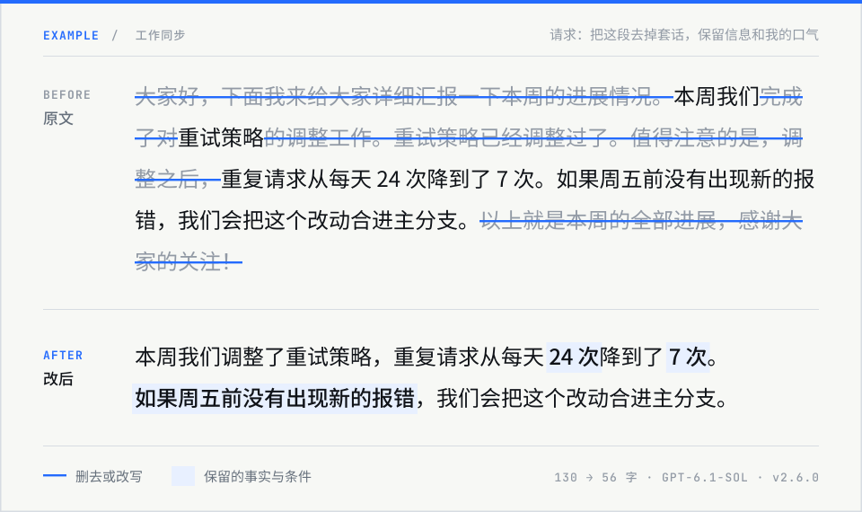

<p align="center">
  
</p>

<p align="center">
  <a href="https://github.com/MrGeDiao/shuorenhua/stargazers"></a>
  <a href="https://github.com/MrGeDiao/shuorenhua/releases"></a>
  <a href="LICENSE"></a>
</p>

说人话是一份给中文去 AI 味的改稿规则（skill），装进 Claude Code、Codex、Cursor、ChatGPT 就能用。它删掉套话、重复铺垫和绕弯句式，交回一版能直接发出去的稿子；数字、条件、承诺和你的口气默认留着，本来没问题的文字不动。

```bash
npx skills add MrGeDiao/shuorenhua
```

<p align="center">
  
</p>

<details>
<summary>看不清图？这里是文字版，可以复制去试</summary>

原文：

> 大家好，下面我来给大家详细汇报一下本周的进展情况。本周我们完成了对重试策略的调整工作。重试策略已经调整过了。值得注意的是，调整之后，重复请求从每天 24 次降到了 7 次。如果周五前没有出现新的报错，我们会把这个改动合进主分支。以上就是本周的全部进展，感谢大家的关注！

改后：

> 本周我们调整了重试策略，重复请求从每天 24 次降到了 7 次。如果周五前没有出现新的报错，我们会把这个改动合进主分支。

请求是「把这段去掉套话，保留信息和我的口气」，由 GPT-6.1-sol 加载 v2.6.0 跑出，输出没有手改。同一段交给 Claude Opus 5.5，结果只多留了「调整之后，」。

</details>

## 四种常用改法

装好后不用记参数，贴上原文、按你的目的说一句要求就行（想确保用上，在要求里点名「用说人话」）：

| 场景 | 你怎么说 | 它怎么做 |
|---|---|---|
| **日常去套话**（默认） | `把这段去掉套话，保留信息和我的口气：……` | 删招呼、预告、重复句和生硬语序，拿不准的地方留着不动，只交改好的全文 |
| **去掉宣传腔**（写平实） | `别吹，写平实点：……` | 把「极致」「完美」这类只表示程度的夸张词换成平常话，删空口号；承诺、「首个」和数字照留 |
| **黑话长文把关**（修订稿） | `彻底清理，黑话都换成大白话：……` 或 `给我一份修订稿，逐条列出改动，我来决定留哪些：……` | 先列出不碰的说法（`不动：`），拿不准的黑话也改并标「猜的」，不同意哪条回复编号逐字还原 |
| **只审稿不改文** | `只标问题，不改写：……` | 只引用有毛病的片段并说明怎么改，不替换全文 |

默认保持原文语言（中文为主，英文也能改），程序代码块默认原样保护。它不判断文章是不是 AI 写的，也不保证能通过 AI 检测。

<details>
<summary>展开看「写平实」例子与改动范围控制（structural / bounded / in-place）</summary>

### 写平实：去掉宣传腔（v2.6 起）

只有明确说了「别吹」「写平实点」「去掉营销味」，它才会多做一步：把只表示程度的夸张词换成平常说法，删掉不交代内容的口号（只说「去 AI 味」「改狠一点」不会打开）：

> 这款记账软件采用全新一代同步引擎，带来极致流畅的体验，真正做到无需妥协。它是国内首个支持离线多人协作的记账工具，导入旧数据无需手动整理，同步速度提升了 3 倍。

改成：

> 这款记账软件采用新一代同步引擎，用起来很流畅。它是国内首个支持离线多人协作的记账工具，导入旧数据无需手动整理，同步速度提升了 3 倍。

「国内首个」（可核查声明）、「无需手动整理」（承诺）、「3 倍」（数字）照样保留，只降调，不加强。

### 控制改动范围

约 1000 字以上的中文公开长文，默认保留原来的段落和句子结构。你也可以直接指定：

| 要求 | 改动范围 |
|---|---|
| 自由调整 / `structural` | 可删、并、重排，保留有效信息和作者意图 |
| 保留结构 / `bounded` | 只在句内清理；整句删除只列在文后待确认，不并句、不重排 |
| 只在原位改 / `in-place` | 不删句、不并句、不重排；要求保句数时也不拆句 |

</details>

## 修订稿：对付黑话多的长文

长文里的黑话，默认模式改得偏少：规则是拿不准就留着，而「打通心智」「底层逻辑」正好是说不清具体指什么的词。修订稿反过来做，拿不准的也改，但每一处都列在全文前面，由你决定留不留。

只有你说了「修订稿」「逐条列出改动」「彻底清理」或「所有黑话都换成大白话」才会进入这个模式。只说「去 AI 味」「改狠一点」不会。

### 它交回什么

下面是 Claude Code（Opus 5.5）在 v2.7.0 跑出的真实输出。原文是一篇约 2400 字、讲企业数字化转型的 AI 生成文章，请求是「请彻底清理这篇文章的 AI 味，所有黑话都换成大白话；保留原来的段落和结构，不删句、不并句；用修订版或批注格式标出改动」。这里只节选三段，省略处标 `……`，其余一个字没改：

```text
判断：黑话较多
不动：“转”（贯穿全文的说法）、“赋能”、“中台”、“智能化”（被讨论的词）、……、“管控者”、“设界者”、“提问者”（作者起的角色名）、……、动销、单品、复购、口径、订单履约周期、库存周转（行业术语和指标）

## 改动清单

……

### 第 9 段

8. 【等义】
原文：中层掌握汇总
改为：中层掌握汇总的信息
理由：“汇总”缺宾语，本句讲信息差，只能指汇总的信息

9. 【猜的】
原文：基层只看到执行
改为：基层只看到手头要做的事
理由：生造搭配，“执行”选了“手头要做的事”这种读法

### 第 10 段

10. 【等义】
原文：把透明又堵了回去
改为：让数据又不透明了
理由：比喻，上文的“透明”指数据透明

11. 【猜的】
原文：用旧思维驾驭新工具
改为：用老想法对待新工具
理由：“驾驭”取了“对待”这层共同义，原词的掌控意味变淡

### 第 11 段

12. 【等义】
原文：信息不再是稀缺资源
改为：信息不再难得
理由：“稀缺资源”是包装词，这里就是不难得到

……

## 修订稿

……

传统企业的管理权威，很大程度建立在信息差上：老板知道全局，中层掌握汇总的信息，基层只看到手头要做的事。数字化恰恰在抹平这种信息差——数据透明了，报表实时了，一线能直接看到过去只有高管才看的经营数据。

有些管理者本能地抗拒这种透明：担心数据被"误读"，担心下属"看到不该看的"，于是给系统加上层层权限，让数据又不透明了。这其实是用老想法对待新工具。

思路需要换一个方向：当信息不再难得，管理层的价值就不在"掌握信息"，而在三件事上——

……

回复“撤销 2、5”可撤销指定条目；也可以回复“撤销所有猜的”“全部撤销”“全收”“再过一遍”。
```

这篇一共列了 37 条（21 条 `等义`、16 条 `猜的`）；测过回复 `撤销 12、20、37`，三处都逐字还原，其余改动不受影响。

### 怎么读、怎么撤

动笔前第二行的 `不动：` 先把不能碰的说法列出来，后面原样留下：作者自己起的名字、贯穿全文的对照、引语、行业术语（「动销」「口径」「库存周转」读者不熟也不换）。每条改动标一种标签：

- **【等义】**：意思没变，只换了说法，扫一眼，偶尔也会标错。
- **【猜的】**：原文说不清，选了一种读法并在理由里写明，**请逐条把关**。
- **【删除】**：删掉只起造势作用的成分，看删了之后少没少意思。
- **【校对】**：错字、漏字和明显的语病。

看完直接回复就能回退：`撤销 2、5`（这两处逐字还原）、`撤销所有猜的`（只留等义、删除、校对）、`全部撤销`（交回原文）、`全收`（当前稿定稿）、`再过一遍`（找漏掉的，撤过的不再提）。

## 安装

**Claude Code**

```text
/plugin marketplace add MrGeDiao/shuorenhua
/plugin install shuorenhua@shuorenhua
```

**Codex、Cursor 和其他支持 skills 的工具**

```bash
npx skills add MrGeDiao/shuorenhua
```

只装 4 个运行文件，不带评测脚本和历史材料。默认对当前项目生效，加 `--global` 后所有项目都能用。

**ChatGPT**：新建一个 Project，传入 4 个运行文件，步骤见 [ChatGPT 安装说明](install/chatgpt.md)。OpenAI 计划在 2026 年 12 月 11 日停用 Custom GPT，旧版说人话 GPT 届时失效。

**单文件免安装 / 手动复制**：临时使用或输入空间有限时，贴 [dist/shuorenhua-mini.md](dist/shuorenhua-mini.md)（1,500 字符以内，不含修订稿）。手动配置见 [Claude Code](install/claude-code.md)、[Codex](install/codex.md)、[Cursor / Windsurf](install/cursor.md)、[OpenClaw](install/openclaw.md)。

## 测试结果

### 默认改写

用一套 123 条的主集测试（65 条需要清理，58 条本来没问题、不该改；另有 7 条专门看改完是不是更好读），按事先写好的[编辑质量判据](evals/v2.5/criteria.md)逐条判。

- 主集 123 条跑的是 `claude-opus-5`：v2.6.0 的完整结果里，没问题的 58 条一条都没被改坏，7 条里 5 条改完更好读，1 条丢了信息（B-33，见已知局限）。v2.7.0 的默认规则只多了一段路由，抽跑了 30 条，没有比 v2.6.0 差，也没有误入修订稿。
- 另外，v2.5.0 时 `grok-4.6` 跑过主集定向 43 条及 13 条场景与独立文本（共 56 条，硬失败为 0）；v2.6.0 的「写平实」小测（3 篇宣传文本 + 1 篇新闻 + 4 条探针）在 `claude-opus-5` 和 `gpt-6.1-sol` 上跑过。其他模型和工具没有跑过主集。

### 修订稿

11 篇长文（5 篇 AI 味重的文章、3 篇维基新闻、2 篇人写的中文文本、1 篇本地授权文章）和三种撤销，在真实的 Claude Code 2.1.321（`claude-opus-5-5`）和 Codex CLI 0.167（`gpt-6.1-sol`）里各跑一次，规则文件由工具自己去读。请求都是上面例子里那一句。`claude-fable-5-2` 对其中 8 篇逐条盲审，它拿不准的条目一律算错：

| 项 | 过关线 | Claude Code（Opus 5.5） | Codex（GPT-6.1-sol） |
|---|---|---|---|
| 清单格式能解析 | 11/11 | 11/11 | 11/11 |
| 清单条目能在原文里找到 | ≥95% | 312/312 | 339/340 |
| 清单之外的实质改动 | 0 | 0 | **1，没过** |
| 三种撤销逐字还原 | 3/3 | 3/3 | 3/3 |
| 每篇改错（含拿不准的） | ≤1.8 处 | 1.62 | **2.5，没过** |
| 「等义」标错 | ≤10% | 3/122 | 4/70 |

- **Codex 没过的两项**：那 1 处实质改动是一条「删除」写成了保留下来的文字而不是 `（删除）`，程序对不上，改动在清单里看得见；确定改错的数量和 Claude Code 差不多（每篇 0.62 处对 0.75 处），差在拿不准的条目多一倍（15 条对 7 条），全算成错就过不了线。
- **其他环境**：Gemini、DeepSeek、Grok 只用旧规则做过程序检查，没有审过改得对不对；ChatGPT 和 Cursor 没有测过。
- **读这些数字要知道三件事**：每篇只跑了一次，换一次运行数字会变；判分的模型和 Claude 是同一家的，可能对 Claude 偏松，没有第三方复核；过关标准改过三次，每次都是看过上一轮结果后改的，最后一次把「黑话改到位的比例」和「要你拿主意的条数」降成了只记录——按改之前的标准，两个环境都不过（Claude Code 改到位 35 个，线是 36 个）。

<details>
<summary>展开只记录的补充指标（黑话覆盖数、每千字条数等）</summary>

| 项 | Claude Code（Opus 5.5） | Codex（GPT-6.1-sol） |
|---|---|---|
| 每篇确定改错（不算拿不准的） | 0.75 处 | 0.62 处 |
| 44 个该改的黑话，改到位的 | 35 | 34 |
| AI 味重的长文，每千字改动 | 18.6 条 | 16.7 条 |
| 其中要你拿主意的（猜的、删除） | 7.9 条 | 10.7 条 |
| 正常长文，每千字要你拿主意的 | 0.7 条 | 1.2 条 |
| 换掉了不该换的术语 | 0 | 2 |

详细过程见 [v2.7.1 定向测试](evals/results-v2.7.1.md)、[v2.7.0 评测](evals/results-v2.7.0.md)、[v2.6.0 评测](evals/results-v2.6.0.md) 和 [主集用例](evals/benchmark.md)。

</details>

**v2.7.1 定向测试**：针对本版四处规则改动，在真实的 Claude Code（纯 `claude-opus-5-5`）和 Codex（`gpt-6.1-sol`）上跑了 3 篇问题长文和 3 道默认短题（共 12 次调用）：6 份修订稿定位 134/134、清单外实质差异 0、不再出现段号错标；两篇繁体新闻的总条数均比 v2.7.0 减少，但两个模型都仍有少量越界校对残留（如 Claude 仍把「首家富商」改成「首富」，Codex 把粤语新闻里的「記得指」删成「記得」）；`B-33` 两边都保住了前半句应承，但短题运行中两边都只读了 `SKILL.md`、没读 `editing-guide.md`，不能证明新增的那句说明起了作用。这次没有跑模型主审，也没有重跑其余 8 篇长文、撤销和 123 条主集，上面的全量数字仍来自 v2.7.0 和 v2.6.0，详见 [v2.7.1 验证记录](evals/results-v2.7.1.md)。

## 已知局限

**默认改写**

- **改得保守。** 「为后续发展奠定了坚实的基础」这类评价算作者的判断，默认会留着；想去掉宣传腔要明确说「别吹」。较长的公开文章里黑话和叠用比喻清得偏少，想多改请要修订稿（见 [#16](https://github.com/MrGeDiao/shuorenhua/issues/16)）。
- **写平实偶尔误降正常评价。** 测试中把新闻里的「慷慨捐助」改成了「捐助」。
- **代词应承加重复预告的句子曾被整句删掉（B-33）。** 「我帮你把这个事情掰扯清楚，先把它彻底掰开说清楚。」在 v2.6.0 被当成没有内容的预告删空了，丢了前半句承诺。v2.7.1 看着这道题在 `editing-guide.md` 补了一句说明；定向测试里两边都保住了前半句，但因为短题按需查阅时两边都没去读 `editing-guide.md`，且这道题已参与调规则，该问题是否修稳尚未证实。

**修订稿**

- **会改错，标「等义」的也会。** 上面那篇例子里，「流程跨部门一断，就退回微信群和 Excel」被改成「流程一跨部门就断，就退回微信群和 Excel」，标的是「等义」，把条件句改成了断言。定稿前请把清单看一遍，尤其是标「猜的」的。
- **清单长。** AI 味重的长文每千字 17 到 19 条；Claude Code 约四成标「猜的」，Codex 约六成。回复 `撤销所有猜的` 可以一次撤掉，但这部分黑话也就留下了。
- **修订稿是模型照清单写的，不是程序生成的。** v2.7.0 的 22 份里有 1 份因删除格式问题和清单对不上，另 1 份多了一个逗号，都出在 Codex；另有 1 篇长文大半条目的段号标错了（其余 10 篇正常）。v2.7.1 允许带保留字的删除并去掉了硬数段号的要求，3 篇定向测试里实质差异和段号错标均为 0（未重跑 11 篇全量）。有疑问时仍以清单和原文为准，找改动按 `原文` 那一行搜。
- **完整测试只跑过带结构限制的「彻底清理」那句请求。** 测试原句还带了「保留原来的段落和结构，不删句、不并句」；只说「给我一份修订稿，逐条列出改动，我来决定留哪些」时清单短得多，也会漏改：试过一篇，4 个必改的地方只动了 2 个。
- **其他模型不建议用。** Gemini、DeepSeek、Grok 只用旧规则做过程序检查：Gemini 改得很少，DeepSeek 和 Grok 的清单有条目对不上修订稿。ChatGPT 和 Cursor 没有测过。`mini` 和 `lite` 不含这个模式。

## 反馈

改坏了或者改得不够，请用 [Bad Case 模板](.github/ISSUE_TEMPLATE/bad-case.md)贴出原文、你的请求原话和实际输出。不要贴未授权的聊天记录、密钥或个人信息。想参与改规则，先看 [贡献说明](CONTRIBUTING.md)。历次改动见 [CHANGELOG](CHANGELOG.md)。

## 相关项目

- [stop-slop](https://github.com/hardikpandya/stop-slop)：英文冗余表达规则
- [humanizer](https://github.com/blader/humanizer)：英文 AI 写作模式整理
- [avoid-ai-writing](https://github.com/conorbronsdon/avoid-ai-writing)：AI 写作问题分类
- [speak-human-tw](https://github.com/Raymondhou0917/speak-human-tw)：繁体中文编辑规则

## Star 增长

[](https://github.com/MrGeDiao/shuorenhua/stargazers)

## English

**shuorenhua** is a Chinese-first editing skill (instructions your AI tool loads) for Claude Code, Codex, Cursor, and ChatGPT. It removes AI-sounding filler, repetition, and stiff phrasing while keeping facts, conditions, commitments, and the writer's voice. It also handles English, and can point out problems without rewriting. It is not an AI-authorship detector.

In revision mode (`修订稿`), it lists domain terms to leave untouched, shows every edit before the full text (`等义` equivalent, `猜的` guess, `删除` deletion, `校对` proofreading), and lets you undo any item by number. It edits more than the default mode and makes more mistakes, so read the list before accepting it. Install with `npx skills add MrGeDiao/shuorenhua`.

## 许可

[MIT](LICENSE)
