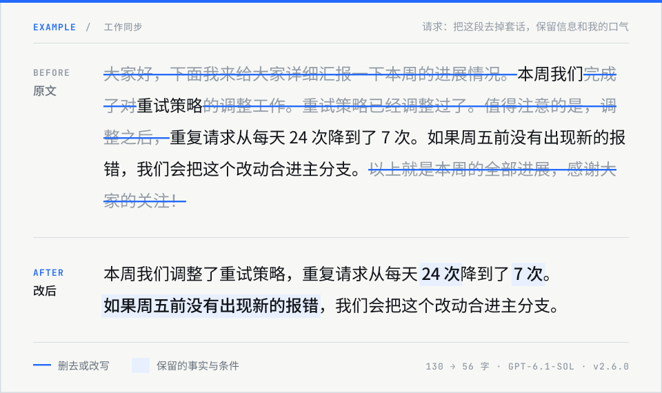

<p align="center">
  
</p>

<p align="center">
  <a href="https://github.com/MrGeDiao/shuorenhua/stargazers"></a>
  <a href="https://github.com/MrGeDiao/shuorenhua/releases"></a>
  <a href="LICENSE"></a>
</p>

说人话是一份装进 Claude Code、Codex、ChatGPT 等工具里的改稿规则（skill）。把写好的文字交给它，它会删掉套话、重复铺垫和生硬句式，交回一版能直接用的稿子。数字、条件、承诺和你的口气保持原样，本来就没问题的文字不动。

一行命令装好，Claude Code、Codex、Cursor 都能用，其他方式见[安装](#安装)：

```bash
npx skills add MrGeDiao/shuorenhua
```

<p align="center">
  
</p>

<details>
<summary>看不清图？这里是文字版，可以复制去试</summary>

原文：

> 大家好，下面我来给大家详细汇报一下本周的进展情况。本周我们完成了对重试策略的调整工作。重试策略已经调整过了。值得注意的是，调整之后，重复请求从每天 24 次降到了 7 次。如果周五前没有出现新的报错，我们会把这个改动合进主分支。以上就是本周的全部进展，感谢大家的关注！

改后：

> 本周我们调整了重试策略，重复请求从每天 24 次降到了 7 次。如果周五前没有出现新的报错，我们会把这个改动合进主分支。

请求是「把这段去掉套话，保留信息和我的口气」，由 GPT-6.1-sol 加载 v2.6.0 跑出，输出没有手改。同一段交给 Claude Opus 5.5，结果只多留了「调整之后，」。

</details>

## 安装

**Claude Code**

```text
/plugin marketplace add MrGeDiao/shuorenhua
/plugin install shuorenhua@shuorenhua
```

**Codex、Cursor 和其他支持 skills 的工具**

```bash
npx skills add MrGeDiao/shuorenhua
```

运行后选择要装到哪些工具。加 `--global` 装到用户目录，所有项目都能用。

**ChatGPT**：直接用[说人话 GPT](https://chatgpt.com/g/g-6a5829b1163481919e1e45851f6bc709-shuo-ren-hua)，不用安装。

想手动复制文件、装到 OpenClaw，或只想贴一段提示词，见[安装说明](install/)。

## 怎么用

装好后不用记命令，在对话里贴上原文、说一句要求，工具会自己调用；想确保用上，可以在要求里点名「用说人话」。

```text
把这段去掉套话，保留信息和我的口气：……
只在句内改，不删句、不并句：……
别吹，写平实点：……
只标问题，不改写：……
```

默认只交改好的全文，不附评分和解释。原文没问题时原样返回。中文为主，英文也能改。

## 改什么，留什么

| 会清理 | 会保留 |
|---|---|
| 没有内容的招呼、预告和致谢 | 数字、日期、版本号 |
| 「值得注意的是」这类提示语 | 条件、承诺和分寸：「如果」「得到批准后」「可能」 |
| 「完成了对……的调整工作」这类绕弯的说法 | 引语、术语、代码块 |
| 同一件事说两遍 | 你的判断和口气，默认连像宣传的评价也留着 |

它不判断文章是不是 AI 写的，也不保证能通过 AI 检测。

<details>
<summary>控制改动范围</summary>

| 要求 | 改动范围 |
|---|---|
| 自由调整 / `structural` | 可删、并、重排，保留有效信息和作者意图 |
| 保留结构 / `bounded` | 只在句内清理；整句删除只提建议，不并句、不重排 |
| 只在原位改 / `in-place` | 不删句、不并句、不重排；要求保句数时也不拆句 |

你的要求优先。约 1000 字以上的中文公开长文，默认保留原来的段落和句子结构。

</details>

<details>
<summary>写平实：去掉宣传腔（v2.6）</summary>

只有你说了「别吹」「写平实点」「去掉营销味」，它才会多做一步：把只表示程度的夸张词（「极致」「完美」）换成平常说法，删掉不交代内容的口号：

> 这款记账软件采用全新一代同步引擎，带来极致流畅的体验，真正做到无需妥协。它是国内首个支持离线多人协作的记账工具，导入旧数据无需手动整理，同步速度提升了 3 倍。

改成：

> 这款记账软件采用新一代同步引擎，用起来很流畅。它是国内首个支持离线多人协作的记账工具，导入旧数据无需手动整理，同步速度提升了 3 倍。

承诺、可核查的「首个」、数字和术语照样保留。只降调，不加强。只说「去 AI 味」「改狠一点」不会打开。

</details>

## 效果怎么验证

每次发版前跑一套 123 条的测试：65 条需要清理，58 条本来就没问题、不该改。另有 7 条专门看「改完是不是更好读」。改写结果按事先写好的判据逐条判，先看事实和请求有没有被违背，再看是不是更好读。

v2.6.0 的结果：没问题的 58 条一条都没被改坏；7 条里 5 条改完更好读；123 条里有 1 条丢了信息（B-33，见下）。

详细记录见 [v2.6.0 评测](evals/results-v2.6.0.md)、[主集用例](evals/benchmark.md)和[编辑质量判据](evals/v2.5/criteria.md)。

## 已知局限

- **默认改得保守。** 「为后续发展奠定了坚实的基础」这类评价算作者的判断，默认会留着；想去掉宣传腔要明确说「别吹」。不同模型差别也不小：另一段测试里，GPT 按规则留下了这类评价，Claude 整句删了。
- **长文改得偏少。** 较长的公开文章里，黑话和叠用的比喻清理不够。放宽规则后，它会把作者的话说轻或说重，还没找到稳妥的办法，讨论见 [#16](https://github.com/MrGeDiao/shuorenhua/issues/16)。
- **写平实偶尔误降正常评价。** 测试中把新闻里的「慷慨捐助」改成了「捐助」。
- **只有预告的句子可能被整句删掉（B-33）。** 「我帮你把这个事情掰扯清楚，先把它彻底掰开说清楚。」被当成没有内容的预告删掉了，但前半句是交付承诺。

## 反馈

改坏了或者改得不够，请用 [Bad Case 模板](.github/ISSUE_TEMPLATE/bad-case.md)贴出原文、你的请求和实际输出。不要贴未授权的聊天记录、密钥或个人信息。想参与改规则，先看[贡献说明](CONTRIBUTING.md)。

历次改动见 [CHANGELOG](CHANGELOG.md)。

## 相关项目

- [stop-slop](https://github.com/hardikpandya/stop-slop)：英文冗余表达规则
- [humanizer](https://github.com/blader/humanizer)：英文 AI 写作模式整理
- [avoid-ai-writing](https://github.com/conorbronsdon/avoid-ai-writing)：AI 写作问题分类
- [speak-human-tw](https://github.com/Raymondhou0917/speak-human-tw)：繁体中文编辑规则

## Star 增长

[](https://github.com/MrGeDiao/shuorenhua/stargazers)

## English

**shuorenhua** is a Chinese-first editing skill for Claude Code, Codex, Cursor and ChatGPT. It cuts filler, repetition and stiff phrasing while keeping facts, conditions, commitments and the writer's voice. It also handles English and review-only requests. It is not an AI-authorship detector. Install with `npx skills add MrGeDiao/shuorenhua`.

## 许可

[MIT](LICENSE)
